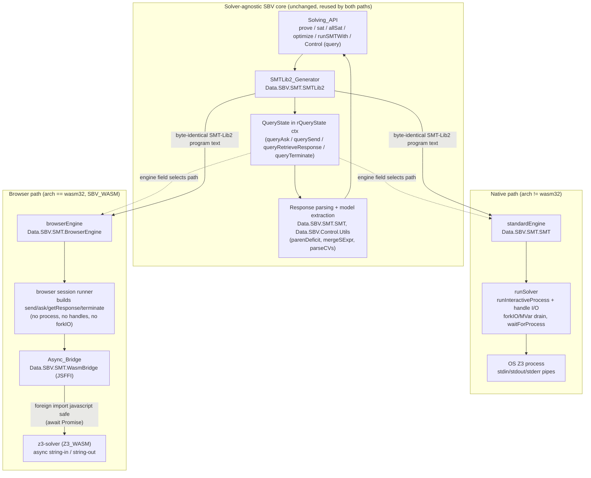

# Design Document

## Overview

This design introduces **SBV_Browser**: a browser-usable build of SBV (v14.2) that drives an
in-browser WebAssembly SMT solver (primary target: the Microsoft `z3-solver` npm package,
**Z3_WASM**) instead of spawning an operating-system solver process. SBV_Browser is the SMT backend
for Grisette running in the browser. Compiling Grisette itself to WebAssembly is out of scope.

The central observation is that SBV already isolates *how it talks to a solver* behind a single,
narrow seam:

```haskell
-- Data.SBV.Core.Symbolic
type SMTEngine =  forall res.
                  SMTConfig -> State -> Text -> (State -> IO res) -> IO res

data SMTSolver = SMTSolver { name :: Solver, executable :: String
                           , preprocess :: Text -> Text, options :: SMTConfig -> [String]
                           , engine :: SMTEngine            -- <- the plug-point
                           , capabilities :: SolverCapabilities }
```

Every solver SBV knows about plugs an `engine` into this field. The native Z3
(`Data.SBV.Provers.Z3.z3`) uses `engine = standardEngine "SBV_Z3" "SBV_Z3_OPTIONS"`, which threads
through `standardSolver` → `pipeProcess` → `runSolver`. `runSolver` spawns the process with
`runInteractiveProcess`, builds `send`/`ask`/`getResponseFromSolver`/`terminateSolver`/`cleanUp`
closures over the stdin/stdout/stderr handles, packages them into a `QueryState`, stores that in
`rQueryState ctx`, and invokes the continuation. Everything *above* this seam — SMT-Lib2 generation
(`Data.SBV.SMT.SMTLib2`), s-expression collection via `parenDeficit`, response parsing, model
extraction (`Data.SBV.SMT.SMT`, `Data.SBV.Control.Utils`) — is solver-transport agnostic.

The design therefore adds a **second engine implementation** — **Browser_Engine** — that has the
same shape as `runSolver` but, instead of an OS process, talks to Z3_WASM through GHC's WebAssembly
**JSFFI**. The Browser_Engine builds a `QueryState` whose `queryAsk` / `querySend` /
`queryRetrieveResponse` fields call JSFFI imports that `await` the `z3-solver` Promise and hand the
response back to SBV as a synchronous `IO String`. Because the seam is reused verbatim, **all**
existing SMT-Lib2 generation, s-expression accumulation, response parsing, and model extraction are
preserved unchanged (Requirement 4). This preservation is *structural, not the result of any upward
import*: those stages live **above** the engine seam, in the solver-agnostic callers
(`Data.SBV.SMT.SMT`, `Data.SBV.Control.Utils`, and the `Solving_API`), and they operate on the
`QueryState` closures the browser engine installs — exactly the closures the native engine installs.
`BrowserEngine` does **not** import the parser or model-extraction code to obtain this reuse; it only
installs the same `QueryState`, and the higher layers run their parsing/extraction over it. The one
genuinely shared *function* is the leaf-level accumulation helper `parenDeficit` (from
`Data.SBV.Utils.SExpr`), which both engines import downward. (See *Module layering and import
direction (acyclicity)* under Architecture for why importing the above-seam stages downward would
create an import cycle.)

The rest of the work is cross-cutting plumbing so that the browser code path never references the
three OS modules `System.Process`, `System.Directory`, `System.Environment`. The `libBF` C FFI is
**not** avoided on the browser path: it is retained as a dependency and compiled for the WASM target
from its bundled portable C sources, so SBV's arbitrary-precision floating-point type (`FloatingPoint`/`FP`)
and the IEEE/arbitrary-precision floating-point theories remain present in the browser build and
Grisette compiles against the browser SBV:

- **Async/sync bridge** over the single-threaded GHC WASM runtime (Requirement 3).
- **Build configuration** (CPP + cabal conditionals) that selects browser vs native paths, compiles
  `libBF`'s bundled C sources for the WASM target (so the FP type is retained), and keeps the native
  build behaviorally identical (Requirements 10, 12).
- **Filesystem virtualization** for the transcript sink and `safeWith` (Requirement 11).
- **Concurrency model** for the single-threaded runtime (Requirement 9).
- A ready-to-use **Z3_WASM configuration** (`z3Wasm`) (Requirements 5, 7).

### Key Research Findings

- **GHC WebAssembly backend JSFFI.** The GHC wasm backend exposes a JavaScript FFI in which
  `foreign import javascript` declarations bind Haskell to JS. An import declared with the **`safe`**
  safety level may return a `Promise`; when it does, the GHC wasm RTS **suspends only the calling
  Haskell (green) thread** and yields to the browser event loop until the Promise settles, then
  resumes the thread with the resolved value. This is exactly the async→sync adaptation SBV needs:
  the Haskell side sees an ordinary `IO` action that "blocks", while the browser event loop keeps
  running so the WASM solver can actually compute. Opaque JS handles are carried as `JSVal`. (GHC
  User's Guide, "Using the GHC WebAssembly backend"; content rephrased for compliance with licensing
  restrictions.)
- **`z3-solver` interface.** The official Microsoft Z3 WASM build, distributed as the `z3-solver`
  npm package, must be loaded/initialized once (module instantiation returns a Promise), after which
  it exposes an asynchronous, string-in/string-out interface: a command string is submitted and a
  Promise of the response string is returned. This maps cleanly onto SBV's one-command/one-response
  `ask` model.
- **Native watchdogs are pipe-recovery devices, not solve-time limits.** In `runSolver`,
  `setCommandTimeOut` (2s) and `defaultLineTimeOut` (5s), scaled by `SBV_COMM_TIMEOUT_FACTOR`, wrap
  `hGetLine` reads (`System.Timeout.timeout`) because the native transport reads a pipe line-by-line
  and must detect a stalled/dead pipe. In the WASM single-message model, each command yields exactly
  one *complete* response or a Solver_Failure (Promise rejection / crash), so these watchdogs do not
  apply (Requirement 7.3). The only solve-time bound that carries over is the optional Query_Timeout
  (`queryTimeOutValue :: Maybe Int`, microseconds; `Nothing` = wait forever), which is a user-facing
  semantic limit, not a transport device.
- **`libBF` compiles for the WASM target from bundled portable C.** The `libBF` Haskell binding
  (`GaloisInc/libBF-hs`) ships its own portable C sources (`libbf.c`, `cutils.c`, `cbits/libbf-hs.c`)
  via cabal's `c-sources` and has **no system-library dependency** (notably, no GMP). The GHC
  `wasm32-wasi` backend compiles `c-sources` with its bundled clang against `wasi-libc`, so the
  bundled `libBF` C compiles and links for the WASM target like any other portable C dependency. This
  is what lets the browser build retain SBV's `FloatingPoint`/`FP` type rather than excluding it.
  Grisette depends on that type at **compile time** — it defines
  `newtype FP eb sb = FP { unFP :: FloatingPoint eb sb }` with
  `type SBVType (FP eb sb) = SBV.SBV (SBV.FloatingPoint eb sb)` — so excluding
  `Data.SBV.Core.SizedFloats` would delete `FloatingPoint` and break Grisette's compilation. Retaining
  and compiling `libBF` is therefore required, not optional. (To be confirmed by an actual
  `wasm32-wasi-cabal` build; high confidence based on the binding's portable, dependency-free C.)

## Architecture

### How the browser path parallels the native path



The selection happens entirely through the `engine` field of the `SMTSolver` value chosen by the
caller's `SMTConfig`. Native Z3 uses `standardEngine`; Z3_WASM uses `browserEngine`. SBV's command
coordination (`sendAndGetSuccess`, the `(set-option :print-success true)` heartbeat, push/pop, model
queries) is implemented *above* the engine and is identical on both paths.

### Command/response lifecycle on the browser path

```mermaid
sequenceDiagram
    participant SBV as SBV core (ask/send)
    participant BE as browserEngine closures
    participant BR as WasmBridge (JSFFI)
    participant Z3 as Z3_WASM

    Note over BR,Z3: First command triggers one-time load+init (queue meanwhile)
    SBV->>BE: ask mbTimeout command
    alt command empty or ";" comment (after dropWhile isSpace)
        BE-->>SBV: "success"  (synthetic, nothing forwarded)
    else real command
        BE->>BR: sendCommand handle command  (record transcript: SentMsg)
        BR->>Z3: submit string, get Promise
        Note over BR: foreign import javascript safe awaits Promise\n(yields to event loop; single Haskell thread suspended)
        Z3-->>BR: resolve -> response string
        BR-->>BE: response (one complete message)
        Note over BE: accumulate via parenDeficit until balanced AND complete s-expr
        BE-->>SBV: response string  (record transcript: RecvMsg)
    end
```

### Module map

New modules (browser path), CPP/cabal-gated so they are absent from the native artifact's
Solving_API dependency set:

| Module | Role | Mirrors |
|---|---|---|
| `Data.SBV.SMT.WasmBridge` | JSFFI bindings: load/init Z3_WASM, submit command + await Promise, release. Defines the `JSVal` handle and the async→sync primitive. | the handle-level I/O inside `runSolver` |
| `Data.SBV.SMT.BrowserEngine` | `browserEngine :: SMTEngine`; builds `send`/`ask`/`getResponseFromSolver`/`terminateSolver`/`cleanUp` over the bridge, constructs `QueryState`, stores it in `rQueryState`, runs the continuation. Same layer as `SMT.SMT`; imports only `Core.*`/`SMT.Utils`/`Utils.*`/`WasmBridge` (never `SMT.SMT` or `Control.*`). | `runSolver` / `standardSolver` |
| `Data.SBV.Provers.Z3Wasm` | `z3Wasm :: SMTSolver` value (name `Z3`, `engine = browserEngine`, no OS CLI options, browser capabilities). | `Data.SBV.Provers.Z3.z3` |
| `Data.SBV.SMT.TranscriptSink` | Browser-available transcript sink replacing the file-writing transcript functions. | transcript helpers in `Data.SBV.SMT.Utils` |

Modified existing modules:

| Module | Change |
|---|---|
| `Data.SBV.Provers.Prover` | Add `z3Wasm :: SMTConfig` wrapper (`mkConfig Z3Wasm.z3Wasm SMTLib2 [...]`); CPP-select `defaultSMTCfg`; CPP-guard `getCurrentDirectory` in `safeWith`; CPP-guard concurrent combinators. |
| `Data.SBV.SMT.Utils` | Route `startTranscript`/`recordTranscript`/`finalizeTranscript` through the sink abstraction; CPP-guard `findExecutable`. |
| `Data.SBV.Core.Operations`, `Data.SBV.Core.Floating` | No libBF-related change needed on the browser path; `libBF` is compiled for the WASM target so these modules build unchanged. |
| `Data.SBV.Core.SizedFloats`, `Data.SBV.Utils.CrackNum` | Retained in the browser build; `libBF` is compiled for the WASM target so these modules build unchanged (SBV's `FloatingPoint`/`FP` type stays present for Grisette). |
| `sbv.cabal` | `arch(wasm32)` conditionals: define `-DSBV_WASM`, drop `process`/`directory` from the browser dependency set (but **keep** `libBF`), add the new modules; native build unchanged. |

### Code-path selection strategy

Selection uses **architecture detection** rather than a manual flag, so a stock
`wasm32-wasi-cabal build` automatically takes the browser path and a normal build is untouched:

```cabal
if arch(wasm32)
  cpp-options: -DSBV_WASM
  build-depends: libBF      -- libBF is still needed on wasm; its bundled C is compiled by wasm clang
  -- browser dependency set (no process, directory; libBF retained)
else
  build-depends: process, directory, libBF
  -- native dependency set
```

In source, the seam is guarded with `#ifdef SBV_WASM`. The guideline is that **`#ifdef SBV_WASM`
code never imports `System.Process`, `System.Directory`, or `System.Environment`** (the three OS
modules). `LibBF` is **not** on this prohibition list — it is allowed on the browser path because
`libBF` is compiled for the WASM target. The `#else` branch is the verbatim existing code, so the
native build is byte-for-byte behaviorally identical (Requirement 12.5).

### Standard build invocation (Requirement 15)

Because code-path selection relies on architecture detection and cabal conditionals (above), the
build behaves correctly only when it is driven by the project's **standard, unmodified** build
command. Implementation and verification agents MUST therefore invoke exactly:

- **Native target:** `cabal build`
- **WASM target:** `wasm32-wasi-cabal build`

No optimization or alternative compiler flags may be injected on the command line — for example
`-O1`, `-O2`, `-optc-O1`, `--ghc-options`, or any ad-hoc optimization level (Requirements 15.1, 15.2,
15.5). Any build setting that is actually needed (optimization levels, `ghc-options`, `cpp-options`
such as the `arch(wasm32)` `-DSBV_WASM` define shown above, `c-sources` for `libBF`, or solver/solver
options) MUST be encoded in the project's cabal configuration files (`sbv.cabal` stanzas and any
`cabal.project*` files) rather than passed on the command line (Requirements 15.3, 15.4). This keeps
the two standard invocations reproducible: the byte-identical native behavior of Requirement 12.5 and
the `arch(wasm32)` browser path both follow purely from committed configuration, so a reported build
or test result always reflects the standard, unmodified invocation (Requirement 15.6).

### Module layering and import direction (acyclicity)

SBV's module graph is **acyclic by construction**: there are **zero `.hs-boot` files** in the
codebase, so every import resolves downward to a strictly lower layer. The browser additions
**preserve this invariant** — each new module imports only modules at lower layers, and the new chain
structurally *mirrors* the native chain at the same layers. The whole library (native + browser)
builds with no cycles (`cabal build lib:sbv`, exit 0).

The layers below are ordered **lowest first**; a module may import only from layers above it in this
list (i.e. numerically smaller). New modules are shown in **bold**.

1. `Data.SBV.Core.Data`, `Data.SBV.Core.Symbolic` (defines `SMTEngine`, `QueryState`, `State`),
   `Data.SBV.Core.SizedFloats` (`FloatingPoint`) — foundation.
2. `Data.SBV.Utils.Lib`, `Data.SBV.Utils.SExpr` (`parenDeficit`), **`Data.SBV.SMT.TranscriptSink`** —
   leaf helpers. `TranscriptSink` imports nothing else from SBV.
3. `Data.SBV.SMT.Utils` — imports `TranscriptSink` (and Core); exposes `SBVException`, the transcript
   functions, and `mergeSExpr`.
4. **`Data.SBV.SMT.WasmBridge`** — imports only `Data.Text` and (on wasm) `GHC.Wasm.Prim`; **no
   upward SBV dependencies**.
5. **`Data.SBV.SMT.BrowserEngine`** — **same layer as the native `Data.SBV.SMT.SMT`**. Imports only
   `Data.SBV.Core.Data`, `Data.SBV.Core.Symbolic` (`SMTEngine`, `State`), `Data.SBV.SMT.Utils`,
   `Data.SBV.Utils.Lib`, `Data.SBV.Utils.SExpr`, and `Data.SBV.SMT.WasmBridge`.
6. `Data.SBV.Control.Utils`, `Data.SBV.Control.Query`, `Data.SBV.Control` — **above** the engine
   layer. These import `Data.SBV.SMT.SMT` *downward* (`Control.Utils` uses `showModel`, `parseCVs`,
   …). No module at this layer imports `Prover`, `Core.Model`, `Z3Wasm`, or `BrowserEngine`.
7. **`Data.SBV.Provers.Z3Wasm`** — **same layer as the native `Data.SBV.Provers.Z3`**. Imports
   `Data.SBV.Core.Data` and (on wasm) `Data.SBV.SMT.BrowserEngine`.
8. `Data.SBV.Provers.Prover` — the convergence point. Imports **all** `Provers.*` modules (and will
   import `Provers.Z3Wasm`); defines `mkConfig` / `defaultSMTCfg`.
9. `Data.SBV.Core.Model`, `Data.SBV.Dynamic`, `Data.SBV.Client`, … — above `Prover`.

Native ↔ browser parallels (each browser module sits at the identical layer to its native twin):

| Native | Browser | Layer |
|---|---|---|
| `Data.SBV.Provers.Z3` | `Data.SBV.Provers.Z3Wasm` | 7 (solver value) |
| `Data.SBV.SMT.SMT` (`standardEngine` / `runSolver`) | `Data.SBV.SMT.BrowserEngine` (`browserEngine`) | 5 (engine) |
| OS process handles (`runInteractiveProcess`, stdin/stdout/stderr inside `runSolver`) | `Data.SBV.SMT.WasmBridge` | 4 (transport) |

Two rules keep the browser additions acyclic. They are the direct cause of the spurious "cycle"
complaints when "reuse" is mis-read as "import upward":

- **Rule (R1):** `Data.SBV.SMT.BrowserEngine` **MUST NOT** import `Data.SBV.SMT.SMT`,
  `Data.SBV.Control.*`, `Data.SBV.Core.Model`, or `Data.SBV.Provers.Prover`. Those modules are at or
  *above* `BrowserEngine`'s layer (layers 5–8), so importing them downward into a layer-5 module
  creates an import cycle. Response parsing and model extraction live in `Control.Utils` / `SMT.SMT`
  (layers 5–6) and are reused by the **higher-layer callers** operating on the `QueryState` the
  engine installs — `BrowserEngine` never imports them.
- **Rule (R2):** the native command-coordination helper `sendAndGetSuccess` is a **local `let`
  binding inside `runSolver`** in `Data.SBV.SMT.SMT`; it is **not exported** and therefore cannot be
  imported. `BrowserEngine` reproduces the identical `let sendAndGetSuccess = …` flow **locally** (a
  faithful transcription that yields byte-identical command coordination), rather than importing it.

## Components and Interfaces

### 1. `Data.SBV.SMT.WasmBridge` — the JSFFI Async_Bridge

This is the only module that touches JavaScript. It encapsulates loading/initialization, the
async→sync command primitive, and resource release. The async primitive is the crux:

```haskell
-- Opaque handle to the initialized z3-solver instance (a JS object).
newtype WasmSolver = WasmSolver JSVal

-- Load the z3-solver module and create a solver instance.
-- Returns a Promise; with `safe`, the GHC wasm RTS awaits it, suspending only this
-- Haskell thread and yielding to the event loop until init settles.
foreign import javascript safe "sbvZ3Wasm.init()"
  js_initZ3Wasm :: IO JSVal          -- resolves to the solver handle; rejects on load/init failure

-- Submit one complete SMT-Lib2 command string; await the single complete response string.
foreign import javascript safe "$1.send($2)"
  js_send :: JSVal -> JSString -> IO JSString   -- Promise<string>; rejection => Solver_Failure

-- Release the solver instance (idempotent; never throws across the boundary).
foreign import javascript safe "$1.release()"
  js_release :: JSVal -> IO ()
```

Haskell-facing wrappers convert `JSString`/`JSVal`, translate Promise rejections into a structured
failure value, and apply the Query_Timeout:

```haskell
-- One-shot send/receive. `Maybe Int` is the Query_Timeout in microseconds (Nothing = wait forever).
sendCommand :: WasmSolver -> Maybe Int -> Text -> IO (Either SolverFailure Text)

data SolverFailure = SolverRejected  String   -- Promise rejected / solver crashed (Solver_Failure)
                   | SolverTimedOut  String   -- Query_Timeout elapsed
                   | SolverLoadError String    -- failed to load the module      (Requirement 13.1)
                   | SolverInitError String    -- loaded but failed to initialize (Requirement 13.2)
```

The **timeout** (Requirement 13.6) is implemented without `System.Timeout` preempting a blocked
thread: `sendCommand` races the solver Promise against a `setTimeout`-backed Promise on the JS side
(`Promise.race`), so the bound is enforced by the browser event loop itself. When no Query_Timeout
is set, no timer Promise is created and the await is unbounded (matching Native_SBV).

**Ordering invariant (Requirement 3.3).** The bridge keeps a single-slot "in-flight" guard
(`IORef Bool` / an `MVar ()` used purely as a mutex, not for thread draining): `sendCommand` claims
the slot before awaiting and releases it immediately after delivering the response, and refuses to
begin a new await while the slot is held. On the single-threaded runtime, SBV's `ask` is already
strictly sequential, so this guard is defensive; it guarantees that the response delivered to SBV
always corresponds to the most recently sent command.

### 2. `Data.SBV.SMT.BrowserEngine` — `browserEngine :: SMTEngine`

Structurally a transcription of `runSolver`, with OS facilities removed:

```haskell
browserEngine :: SMTEngine
browserEngine cfg ctx pgm continuation = do
   -- 1. Acquire the (lazily, once-initialized) solver handle (see WasmSolverState).
   -- 2. Build closures:
   --      send    :: Maybe Int -> Text -> IO ()
   --      ask     :: Maybe Int -> Text -> IO String
   --      getResp :: Maybe Int -> IO String
   --      terminate, cleanUp
   --    that call WasmBridge.sendCommand instead of TIO.hPutStrLn/hGetLine.
   -- 3. Run the heartbeat (set-option :print-success true), global-declarations, dump pgm
   --    via a LOCAL TRANSCRIPTION of the native `sendAndGetSuccess` flow. That helper is a
   --    local `let` inside runSolver and is NOT exported, so BrowserEngine reproduces the
   --    identical `let sendAndGetSuccess = ...` here rather than importing it from SMT.SMT;
   --    the coordination it produces is byte-identical to native (see Rule R2).
   -- 4. Construct QueryState and store in rQueryState ctx.
   -- 5. continuation ctx, with cleanUp on exception.
```

The closures mirror the native ones precisely, preserving observable behavior:

- **`ask`** reproduces the native short-circuit: after `T.dropWhile isSpace command`, if the result
  is `T.null` or has prefix `";"`, it returns `"success"` and forwards nothing (Requirement 2.5).
  Otherwise it `send`s and collects via `getResponseFromSolver`.
- **`getResponseFromSolver`** reuses the native accumulation logic: it folds each received chunk
  through `parenDeficit`, treating "complete s-expression" and "balanced parentheses" as the
  conditions that must both hold before returning (Requirement 2.4). The reused piece here is the
  leaf-level function `parenDeficit` from `Data.SBV.Utils.SExpr` (which **both** engines import
  downward) — not code imported from `Data.SBV.SMT.SMT`. In the WASM single-message
  model the first message is normally already complete; the accumulation loop remains so that
  multi-line responses behave identically to native and never short-read.
- **No handle I/O**: there are no `hGetLine`/`hReady`/`hGetChar`/`hFlush`/`hClose`/`hGetContents`
  calls; `send`/`ask` delegate to `WasmBridge.sendCommand` (Requirement 2.3).
- **No concurrency primitives for draining**: `terminateSolver` does not use `forkIO`/`MVar` to
  drain stdout/stderr; finalization is `WasmBridge.js_release` (Requirements 8.1, 9.2).
- **`cleanUp`** preserves the native exception contract: on a forwarded exception it releases the
  WASM solver resources and **re-raises the original forwarded exception** (Requirements 8.3–8.5);
  task success is "a complete response to the final command was retrieved", independent of any
  `ExitCode` (Requirement 8.2).

Note on what is *not* in `BrowserEngine`: **response parsing and model extraction are reused, but
`BrowserEngine` neither performs nor imports them.** Those stages run in the higher-layer callers
(`Data.SBV.Control.*`, layer 6) operating on the `QueryState` closures the engine installs, so no
upward import from `BrowserEngine` is needed (and per Rule R1 none is allowed — `Control.*` and
`SMT.SMT` sit at or above the engine layer). Likewise, the command coordination is reused as a
**local transcription** of the unexported `sendAndGetSuccess` `let` (Rule R2), not an import from
`Data.SBV.SMT.SMT`.

The `QueryState` is constructed exactly as native does, so `Data.SBV.Control` query mode works
unchanged (Requirement 6):

```haskell
qs = QueryState { queryAsk              = ask
                , querySend             = send
                , queryRetrieveResponse = getResponseFromSolver Nothing
                , queryConfig           = cfg
                , queryTerminate        = cleanUp     -- session termination (Requirement 6.6)
                , queryTimeOutValue     = Nothing
                , queryAssertionStackDepth = 0
                }
```

Because the whole query block shares one `WasmSolver` handle stored in `rQueryState`, declarations
and assertions persist across `push`/`pop`/`check-sat`/`get-model` (Requirement 6.1, 6.3). The
existing `Data.SBV.Control.Utils.getQueryState`/`modifyQueryState` machinery already rejects
commands when no session is active and tracks `queryAssertionStackDepth`, giving Requirements 6.4 and
6.5 for free on the browser path.

### 3. `Data.SBV.Provers.Z3Wasm` — the Z3_WASM solver value

A direct analog of `Data.SBV.Provers.Z3.z3`, with OS-specific fields neutralized:

```haskell
z3Wasm :: SMTSolver
z3Wasm = SMTSolver
   { name         = Z3
   , executable   = ""                 -- no executable; never looked up (Requirement 7.1)
   , preprocess   = id
   , options      = const []           -- no -nw/-in/-smt2, no CLI args (Requirement 5.2)
   , engine       = browserEngine
   , capabilities = z3WasmCapabilities  -- equals native Z3's caps unchanged (FP retained, Req 10)
   }
```

`z3WasmCapabilities` equals `Data.SBV.Provers.Z3`'s `SolverCapabilities` unchanged, including
`supportsIEEE754 = True`, because the arbitrary-precision/IEEE floating-point paths are retained on
the Browser_Path (`libBF` is compiled for the WASM target), so the front end advertises the same FP
support as native (Requirements 5.6, 10). `Data.SBV.Provers.Prover` adds
the user-facing config and makes it the browser default:

```haskell
z3Wasm :: SMTConfig
z3Wasm = mkConfig Z3Wasm.z3Wasm SMTLib2 [ Control.OptionKeyword ":smtlib2_compliant" ["true"] ]

#ifdef SBV_WASM
defaultSMTCfg = z3Wasm     -- Requirement 7.5
#else
defaultSMTCfg = z3
#endif
```

### 4. Initialization state machine (Requirement 5.3–5.5)

A module-level cell tracks one-time load/init and queues operations during loading:

```haskell
data WasmSolverState = NotLoaded
                     | Loading                 -- init Promise in flight; new ops await it
                     | Ready  WasmSolver
                     | Failed SolverFailure

acquireSolver :: IO WasmSolver
-- NotLoaded -> set Loading, call js_initZ3Wasm, then set Ready/Failed and wake waiters.
-- Loading   -> await the same in-flight init (no re-init; Requirement 5.3).
-- Ready h   -> return h.
-- Failed e  -> throw a descriptive SBVException (Requirement 5.5; no op blocks forever).
```

Because the runtime is single-threaded, "queueing" is await-on-the-same-Promise: every operation
that calls `acquireSolver` while `Loading` suspends on the init Promise and, when it resolves, they
proceed in submission order (FIFO of the event-loop callbacks); on rejection every awaiter throws
(Requirement 5.4, 5.5).

### 5. Transcript sink (Requirement 11.2)

`startTranscript`/`recordTranscript`/`finalizeTranscript` currently call `writeFile`/`appendFile`
(and `findExecutable`). Introduce a sink:

```haskell
data TranscriptSink = FileSink FilePath          -- native
                    | BrowserSink (Text -> IO ()) -- browser: append to an in-memory/console buffer
```

On the browser path the sink is a `BrowserSink` that appends the *same* textual content (start
banner, `SentMsg`/`RecvMsg`/`DebugMsg` records, finalize banner) to a browser-available buffer
(e.g. an in-memory `IORef Text` retrievable by Grisette, or `console.log`), performing no OS file
write (Requirement 11.2). `startTranscript`'s `findExecutable` call is CPP-guarded to a no-op on the
browser path (Requirement 7.1).

### 6. `safeWith` and concurrency (Requirements 11.3, 9)

- **`safeWith`** currently computes `cwd <- getCurrentDirectory` and relativizes source paths. On the
  browser path the `getCurrentDirectory` call is `#ifdef SBV_WASM`-guarded; `mkRelative` becomes
  `id`, so each `SafeResult` reports its source-location path unmodified (Requirement 11.3).
- **Concurrent combinators** (`proveWithAny`/`proveWithAll`/`satWithAny`/`satWithAll`) use the
  `async` package and `forkIO` to race multiple solver *processes*. Racing identical in-browser
  Z3_WASM instances has no value and depends on OS-thread semantics the single-threaded runtime does
  not provide. The design therefore, on the browser path, routes these four combinators to an
  explicit **unsupported-operation** `SBVException` that names the invoked combinator, returned
  **synchronously** (no thread/await), after ensuring no WASM session is left active (Requirements
  9.4, 9.5). Single-solver `prove`/`sat`/`allSat`/`optimize` run on the single thread with no
  `forkIO` (Requirement 9.1). (If a future green-thread mechanism proves viable, Requirement 9.3
  permits swapping the rejection for that mechanism without changing the seam.)

### 7. libBF compilation for the WASM target (Requirement 10)

`libBF` is **kept** as a dependency for the WASM build. Its bundled portable C sources (`libbf.c`,
`cutils.c`, `cbits/libbf-hs.c`, declared via cabal `c-sources`) are compiled by the GHC
`wasm32-wasi` clang toolchain against `wasi-libc`; the binding has no system-library dependency (no
GMP), so nothing external must be provided for the target (Requirement 10.1). Consequently
`Data.SBV.Core.SizedFloats`, `Data.SBV.Core.Floating`, `Data.SBV.Core.Operations`, and
`Data.SBV.Utils.CrackNum` build **unchanged** on the browser path — no CPP bracketing, no omission,
no unsupported-feature stubs (Requirement 10.2). Because `SizedFloats` is retained, SBV's
`FloatingPoint`/`FP` type remains present, which is required for Grisette to compile (Grisette refers
to `SBV.FloatingPoint` in its `SBVType`/`NonFuncSBVBaseType` instances at compile time). The boolean,
bit-vector, unbounded-integer, real, **and** IEEE/arbitrary-precision floating-point theories are all
operational on the Browser_Path (Requirement 10.3), and an arbitrary-precision FP operation executes
through the compiled `libBF` C, producing the same result as native (Requirement 10.4). If the
bundled `libBF` C sources fail to compile or link for the WASM target, the build fails with detailed
compile/link error information rather than silently producing an artifact (Requirement 10.6).

## Data Models

### Engine seam types (existing, reused unchanged)

```haskell
type SMTEngine = forall res. SMTConfig -> State -> Text -> (State -> IO res) -> IO res

data QueryState = QueryState
   { queryAsk                 :: Maybe Int -> Text -> IO String  -- send + await complete response
   , querySend                :: Maybe Int -> Text -> IO ()      -- fire-and-forget send
   , queryRetrieveResponse    :: Maybe Int -> IO String          -- await next complete response
   , queryConfig              :: SMTConfig
   , queryTerminate           :: Maybe C.SomeException -> IO ()   -- session teardown
   , queryTimeOutValue        :: Maybe Int                       -- Query_Timeout (µs); Nothing = forever
   , queryAssertionStackDepth :: !Int                            -- push/pop depth (Req 6.5)
   }
```

The browser path constructs values of these *existing* types; it introduces no parallel abstraction.
`Maybe Int` (the Query_Timeout) flows from `Data.SBV.Control.timeout` through `queryTimeOutValue` to
`WasmBridge.sendCommand`.

### New browser-path types

```haskell
newtype WasmSolver       = WasmSolver JSVal                 -- opaque z3-solver instance handle
data    WasmSolverState  = NotLoaded | Loading | Ready WasmSolver | Failed SolverFailure
data    SolverFailure    = SolverRejected String | SolverTimedOut String
                         | SolverLoadError String | SolverInitError String
data    TranscriptSink   = FileSink FilePath | BrowserSink (Text -> IO ())
```

### JS interop value types

| Haskell | JS | Notes |
|---|---|---|
| `JSVal` | any JS object | opaque handle to the solver instance |
| `JSString` | `string` | the SMT-Lib2 command text and the response text |
| `IO JSString` from a `safe` import | `Promise<string>` | awaited by the RTS; resolution = response, rejection = Solver_Failure |
| `IO JSVal` from `js_initZ3Wasm` | `Promise<object>` | resolution = ready handle, rejection = load/init failure |

All SMT-Lib2 text crossing the boundary is the **unmodified** output of `Data.SBV.SMT.SMTLib2`
(Requirement 4.1); the bridge applies no insertion/deletion/reordering/character-level change.

### Error model

Every browser-path failure surfaces as the existing `Data.SBV.SMT.Utils.SBVException` (so callers
catch the same type as native). `SolverFailure` constructors populate the relevant fields:

| `SolverFailure` | `SBVException` fields populated | Requirement |
|---|---|---|
| `SolverLoadError` | description names Z3_WASM + "loading phase" | 13.1 |
| `SolverInitError` | description names Z3_WASM + "initialization phase" (distinct from load) | 13.2 |
| `SolverRejected` | `sbvExceptionSent` = command, `sbvExceptionReceived` = partial, reason = cause | 2.6, 3.4, 13.4 |
| `SolverTimedOut` | description names the timed-out command | 3.5, 13.5 |
| non-`success`/unparseable to a success-expecting command | `sbvExceptionSent` + `sbvExceptionReceived` (reuses native `sendAndGetSuccess`) | 13.3 |

## Correctness Properties

*A property is a characteristic or behavior that should hold true across all valid executions of a
system — essentially, a formal statement about what the system should do. Properties serve as the
bridge between human-readable specifications and machine-verifiable correctness guarantees.*

PBT applies well here because the bulk of the new logic is **pure or
mock-isolatable**: SMT-Lib2 transmission, s-expression accumulation, command short-circuiting,
ordering, the initialization/stack state machines, transcript formatting, and exception fidelity can
all be exercised with a fake bridge over a large generated input space, with no real solver. Two
end-to-end properties (classification parity, model soundness) genuinely require a solver and run at
a reduced iteration budget. Build/config, type-conformance, and "no-OS-API" guarantees are *not*
property-based (they are smoke/static/integration checks; see Testing Strategy).

Properties are derived from the prework analysis above, consolidating redundant criteria.

### Property 1: Browser transmission is byte-identical to native

*For any* symbolic problem and solver configuration, the sequence of SMT-Lib2 command messages the
Browser_Engine transmits to the WASM_Solver is byte-for-byte identical, and in the same order, to the
sequence Native_SBV transmits to an external solver for the same problem and configuration (excluding
operating-system command-line invocation options), with exactly one message per command and no
insertion, deletion, reordering, or character-level modification.

**Validates: Requirements 2.2, 4.1, 4.2**

### Property 2: Response accumulation returns the complete balanced s-expression

*For any* well-formed solver response (including nested parentheses and parentheses inside string
literals) delivered in arbitrarily split chunks, the Browser_Engine's accumulation returns exactly
the complete s-expression and only once its parentheses are balanced and the s-expression is
complete, never returning early and never over-reading into the next response.

**Validates: Requirements 2.4**

### Property 3: Empty and comment commands are short-circuited

*For any* command string that is empty or, after removing leading whitespace, begins with the comment
marker `;`, the Browser_Engine returns the synthetic `success` response and forwards nothing to the
WASM_Solver.

**Validates: Requirements 2.5**

### Property 4: Responses are delivered in command order, one in flight at a time

*For any* sequence of commands, the Async_Bridge delivers to SBV the response corresponding to each
originating command in the order the commands were sent, and never begins awaiting a subsequent
command's response until the most recently sent command's response has been delivered and the
awaiting state cleared.

**Validates: Requirements 3.3**

### Property 5: Failures surface as an SBVException carrying the command and partial response

*For any* command for which a Solver_Failure occurs — the asynchronous response is rejected, the
solver crashes, the response is unparseable, or a non-`success` response is returned to a
success-expecting command — before a complete balanced s-expression is received, the Browser_Engine
raises an `SBVException` carrying the sent command text and any partial/received response text,
releases the WASM_Solver resources associated with the request, and returns no normal result for that
command.

**Validates: Requirements 1.5, 2.6, 3.4, 13.3, 13.4**

### Property 6: Query_Timeout bounds the wait; absence waits indefinitely

*For any* interaction, when a Query_Timeout is set the Browser_Engine returns the response normally if
it completes within the bound and otherwise raises a timeout `SBVException` identifying the timed-out
command and returns no string result; when no Query_Timeout is set the Browser_Engine waits
indefinitely and imposes no internal default timeout, matching Native_SBV.

**Validates: Requirements 1.6, 3.5, 13.5**

### Property 7: Initialization happens at most once and never strands queued operations

*For any* sequence of solver operations issued while the WASM_Solver is loading, initialization is
performed at most once; if initialization succeeds, all queued operations proceed in their submission
order; if initialization fails, every queued operation fails with a descriptive error and none
remains blocked.

**Validates: Requirements 5.3, 5.4, 5.5**

### Property 8: Query sessions preserve solver state across commands

*For any* sequence of declarations, assertions, `push`, `pop`, `check-sat`, and `get-model` commands
within a single query block, the WASM_Solver state observed by each command matches a reference
SMT assertion-stack model: declarations and assertions remain in effect until a matching `pop`
removes them, and all commands in the block target one shared session.

**Validates: Requirements 6.1, 6.3**

### Property 9: Stack and session operations are rejected when invalid

*For any* `push`/`pop`/`check-sat`/`get-model` command, if no query session is active the command is
rejected with a no-active-session error, is not forwarded to a WASM_Solver, and leaves the
no-active-session state unchanged; if a `pop` would remove more assertion levels than the number of
unmatched `push` commands, it is rejected with an invalid-stack-operation error and the current
session state is preserved; and after a session is terminated via `queryTerminate`, any further
command is rejected.

**Validates: Requirements 6.4, 6.5, 6.6**

### Property 10: Aborting cleanup re-raises the original exception after releasing resources

*For any* forwarded exception and any outcome of releasing WASM_Solver resources (success or
failure), the Browser_Engine releases (or attempts to release) the resources held by the aborted task
and then re-raises exactly that original forwarded exception, never substituting a different exception
(including a resource-release error).

**Validates: Requirements 8.3, 8.4, 8.5**

### Property 11: The transcript sink retains identical content

*For any* sequence of transcript events (start, per-message `SentMsg`/`RecvMsg`/`DebugMsg`,
finalize), the content retained by the browser transcript sink is identical to the content the native
file-writing transcript would produce for the same sequence, and no operating-system file write is
performed.

**Validates: Requirements 11.2**

### Property 12: safeWith reports source-location paths unmodified

*For any* set of source locations, the `SafeResult` list produced by `safeWith` on the Browser_Path
reports each source-location file path unmodified (not relativized to a current working directory)
and is produced without calling `getCurrentDirectory`.

**Validates: Requirements 11.3**

### Property 13: Concurrent combinators are rejected synchronously without leaving a session active

*For any* invocation of a concurrent-solver combinator (`proveWithAny`, `proveWithAll`,
`satWithAny`, `satWithAll`) on the Browser_Path when no browser-compatible concurrency mechanism is
available, the SBV_Browser returns an unsupported-operation error that identifies the invoked
combinator synchronously, without awaiting any operating-system thread or background task, and leaves
no WASM_Solver session active (including any session created by a previous successful operation).

**Validates: Requirements 9.4, 9.5**

### Property 14: Classification matches native

*For any* symbolic problem over the boolean, bit-vector, unbounded-integer, real, and
IEEE/arbitrary-precision floating-point theories, the SBV_Browser returns exactly one classification
from {satisfiable, unsatisfiable, unknown} that is identical to the classification Native_SBV returns
for the same problem when both use the same Z3 version and the same solver configuration.

**Validates: Requirements 14.2** (and 10.3/10.4, since the generators exercise the retained theories
including floating-point executed through compiled `libBF`)

### Property 15: A satisfiable model satisfies every submitted constraint

*For any* satisfiable symbolic problem, the model SBV_Browser returns evaluates every submitted
constraint to true (the assigned variable values may differ from those Native_SBV assigns), and the
model values are produced with SBV's existing model-extraction logic in the same value representation
that Native_SBV produces.

**Validates: Requirements 14.3, 14.4** (and 10.3/10.4, since the generators exercise the retained
theories including floating-point executed through compiled `libBF`)

## Error Handling

All browser-path errors are surfaced as the existing `Data.SBV.SMT.Utils.SBVException`, so callers
(including Grisette) catch exactly the same exception type as on the native path. The distinct
failure modes and their handling:

1. **Load failure** (`SolverLoadError`): the `z3-solver` module cannot be loaded. The init Promise
   rejects; `acquireSolver` transitions to `Failed` and raises an `SBVException` whose description
   identifies Z3_WASM and the **loading** phase. No solving result is returned. (Requirement 13.1)
2. **Initialization failure** (`SolverInitError`): the module loads but instance creation fails. The
   error is tagged with the **initialization** phase and is textually distinguishable from a load
   failure. (Requirement 13.2) Any operations queued during loading all fail with this descriptive
   error; none is left blocked. (Requirement 5.5)
3. **In-flight Solver_Failure** (`SolverRejected`): the response Promise rejects, the solver crashes,
   or the response is unparseable / non-`success` to a success-expecting command. The bridge raises
   an `SBVException` with `sbvExceptionSent` = the command and `sbvExceptionReceived` = any partial
   text, releases the request's WASM resources, and returns no result. This is the browser analog of
   the native `hGetLine: end of file` detection. (Requirements 2.6, 3.4, 13.3, 13.4)
4. **Query_Timeout exceeded** (`SolverTimedOut`): only when a Query_Timeout is set. Enforced by a
   JS-side `Promise.race` against a `setTimeout` timer (Requirement 13.6), so it does not depend on
   `System.Timeout` preempting a blocked Haskell thread. Raises a timeout `SBVException` naming the
   command. With no Query_Timeout, the await is unbounded — no internal default. (Requirements 3.5,
   13.5)
5. **Abort by forwarded exception**: `cleanUp` releases (or attempts to release) WASM resources and
   re-raises the **original** exception; a failure during release does not mask it. (Requirements
   8.3–8.5)
6. **Unsupported operation** (concurrent combinators): rejected synchronously with an `SBVException`
   naming the combinator, leaving no session active. (Requirements 9.4, 9.5)
7. **No active session / invalid stack op**: handled by the existing query machinery
   (`getQueryState`, `queryAssertionStackDepth`), which rejects the command and preserves state.
   (Requirements 6.4, 6.5)
8. **Un-virtualizable filesystem op**: prevented and reported with an explicit error naming the
   unsupported operation; no OS filesystem access occurs. (Requirement 11.4)

## Testing Strategy

The browser path is validated with a **dual approach**: property-based tests for universal behaviors
(the 15 properties above) and unit/integration/build tests for the example, edge, smoke, and
configuration criteria.

### Property-based tests

- **Library**: use an existing Haskell property-testing library — `QuickCheck` (already a
  dependency of SBV's test suite). Do **not** hand-roll property testing.
- **Iterations**: minimum **100** iterations per property (the default 100 for the mock-isolatable
  properties P1–P13; for the solver-backed properties P14–P15 a reduced budget, e.g. 20–50
  iterations, is acceptable given Z3 cost, but still randomized).
- **Tagging**: each property test carries a comment of the form
  `-- Feature: sbv-browser-wasm-backend, Property N: <property text>`.
- **One test per property**: each correctness property is implemented by a single property-based
  test.
- **Mock bridge**: P1–P13 use a `MockBridge` implementing the same `sendCommand`/`acquireSolver`/
  `release` interface as `WasmBridge`, recording every message and producing scripted responses,
  failures, and timing. This isolates the engine logic from any real solver and keeps iterations
  cheap. P1 additionally drives the native engine with a capturing mock transport to compare
  transmitted byte sequences.
- **Generators**: symbolic problems over bool/bit-vector/unbounded-integer/real **and
  arbitrary-precision/IEEE floating-point** theories (FP is retained on the browser path per
  Requirement 10, so arbitrary-precision FP generators are included and exercised); s-expression
  generators that produce nested and string-embedded parentheses with random chunk splits (P2);
  whitespace/comment command generators (P3); push/pop/declare/assert sequences (P8, P9); transcript
  event sequences (P11); arbitrary exceptions and release outcomes (P10).
- **Solver-backed** (P14, P15) run under a harness that can reach both a native Z3 and Z3_WASM at the
  same Z3 version, asserting classification parity and model soundness.

### Unit / example / edge-case tests

- Engine wiring: `z3Wasm`'s `engine` is `browserEngine` (1.2); `defaultSMTCfg == z3Wasm` under
  `SBV_WASM` (7.5); `options (solver z3Wasm) cfg == []` (5.2); `z3WasmCapabilities` equals Z3's
  `SolverCapabilities` unchanged, including `supportsIEEE754 = True` (5.6); the
  `(set-option :print-success true)` heartbeat returns `success` (6.2).
- Unconfigured-fields configuration error (1.4a); load- vs init-phase error distinction (13.1, 13.2);
  un-virtualizable FS op error (11.4); final-command-success independent of ExitCode (8.2).

### Static / structural checks

- The browser Solving_API path references no `System.Process`, `System.Directory`, or
  `System.Environment` symbol (2.1, 2.3, 7.1–7.4, 8.1, 9.2, 11.1, 12.3); the browser
  engine uses no `forkIO`/`MVar` draining and no `commTimeOutScaler`/`setCommandTimeOut`/
  `defaultLineTimeOut` (7.3, 9.2); response parsing and model extraction reuse the existing functions
  with no alternative parser/extractor (4.3, 4.4); the timeout is enforced via the JS-side race, not
  `System.Timeout` (13.6); the browser path exposes the same Solving_API signatures as native (14.1,
  1.1).

### Build / integration smoke tests (CI)

- Native build succeeds and uses the process-based engine (12.1, 12.6); the existing native test
  suite (including golden files) passes unchanged, demonstrating behavioral identity (12.5, 10.5).
- The `arch(wasm32)` build succeeds and produces a loadable artifact (10.1, 12.2); the artifact
  **links** `libBF` (its bundled portable C compiled in), and an arbitrary-precision floating-point
  solve works through the compiled `libBF` (10.1, 10.3, 10.4). If the bundled `libBF` C sources fail
  to compile or link for the WASM target, the build fails with detailed errors rather than silently
  producing an artifact (10.6). Separately, a partial-exclusion check verifies that a leftover
  `System.Process`/`System.Directory`/`System.Environment` dependency on the Solving_API path fails
  the build with detailed errors rather than producing a partial-exclusion artifact (12.4).
- In a real browser/wasm runtime, single-solver `prove`/`sat`/`allSat`/`optimize` complete on the
  single thread without deadlocking the event loop (3.2, 9.1).
